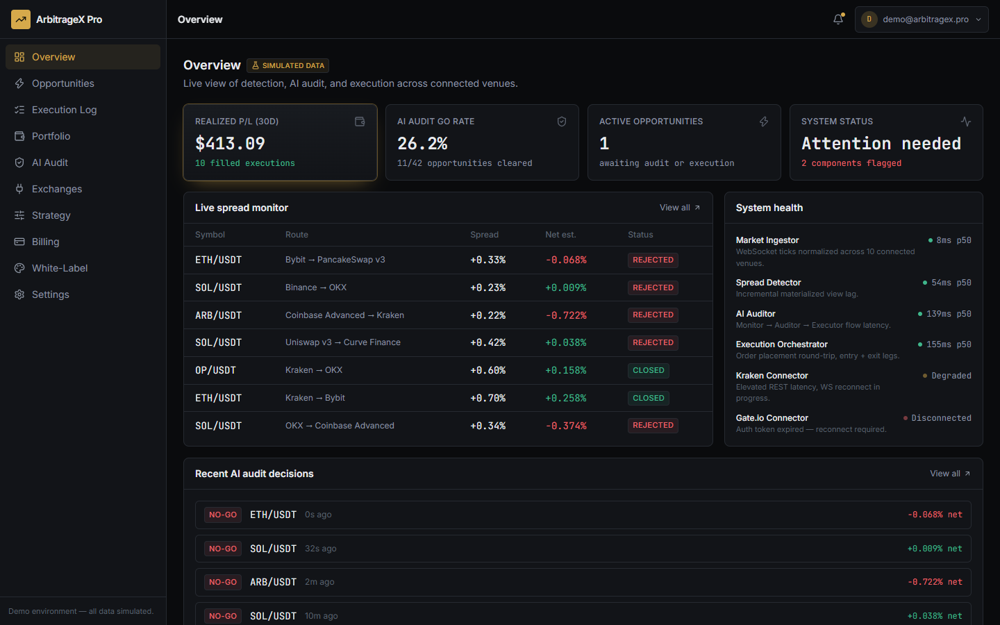
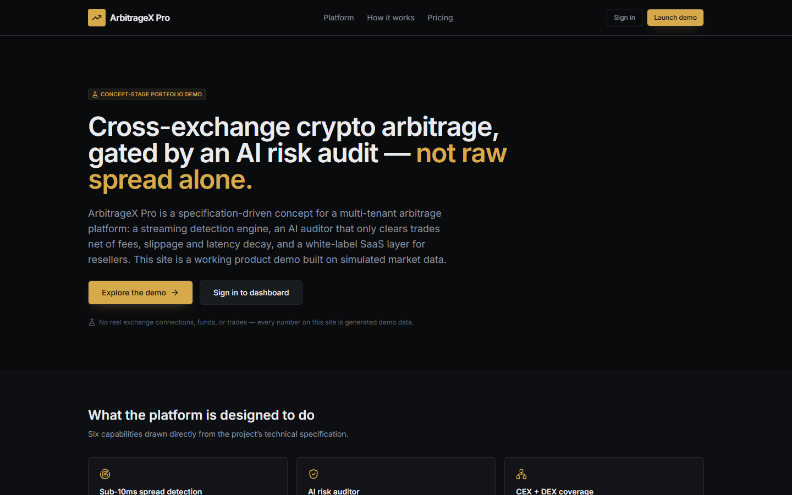
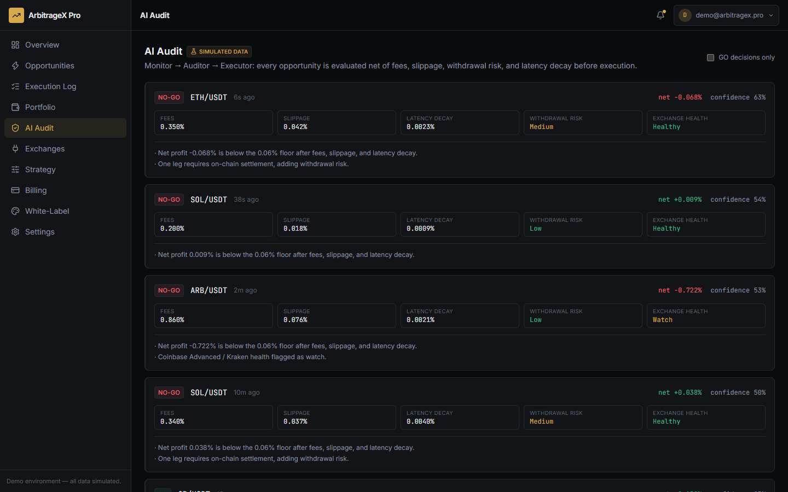
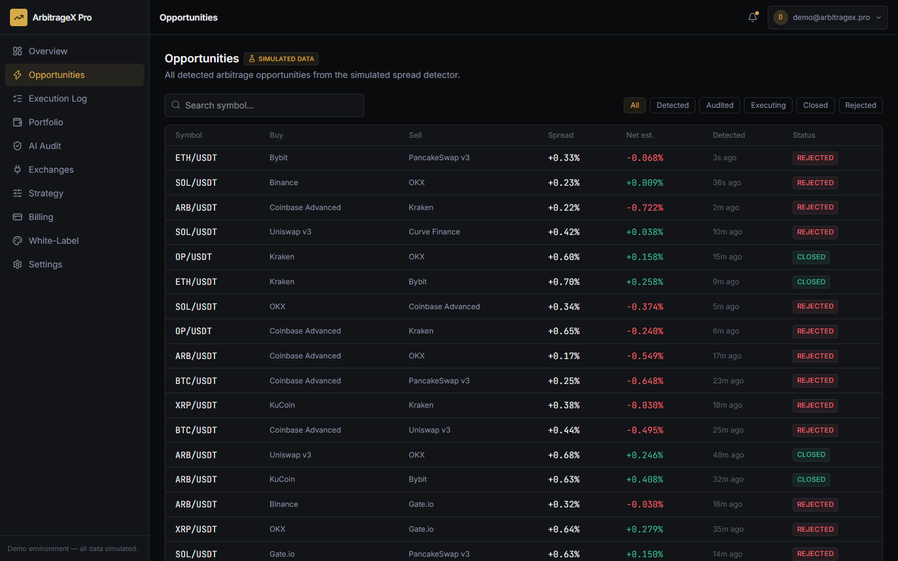
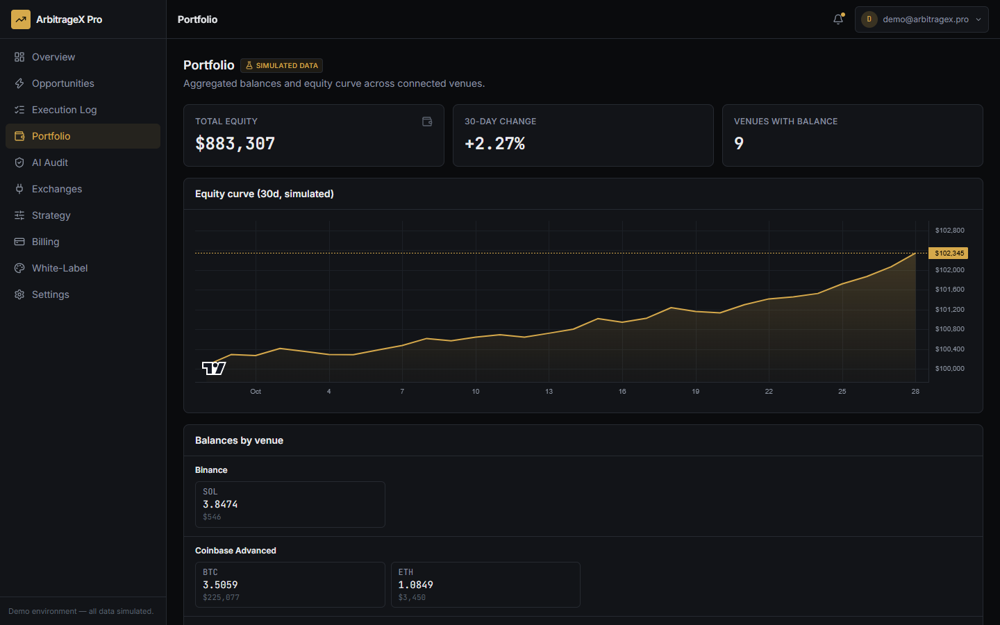

# ArbitrageX Pro

**Status: Concept-stage portfolio demo.** A working Next.js product demo of a
cross-exchange crypto arbitrage SaaS platform — polished frontend, a
deterministic simulated data layer, and full product documentation. There is
no real backend, no real exchange connectivity, no real funds, and no real
users. See [`docs/LIMITATIONS.md`](docs/LIMITATIONS.md) for the exact
REAL / MOCKED / SIMULATED / PROPOSED breakdown before relying on anything here.




## Problem

Crypto prices diverge across 100+ centralized and 25+ decentralized exchanges.
Capturing that spread profitably requires detecting it in milliseconds,
netting out fees/slippage/withdrawal risk/latency decay before committing
capital, and executing both legs atomically. Most existing tools are
single-venue, manual, CEX-only, or execute on raw spread without a real net-profit
gate — see [`docs/PROJECT_CONTEXT.md`](docs/PROJECT_CONTEXT.md) for the full
competitive comparison this project was scoped against.

## Solution

ArbitrageX Pro's target architecture (see
[`docs/ARCHITECTURE.md`](docs/ARCHITECTURE.md)) is a streaming market
ingestor + incremental spread detector, gated by an AI risk auditor that only
clears a trade when it is profitable **net of fees, slippage, withdrawal
risk, and latency decay** — not on raw spread — followed by an execution
orchestrator that places both legs with rollback safeguards. It's designed as
a multi-tenant, white-label SaaS platform with local banking and crypto
payment rails.

This repository implements the **product layer** of that vision: the full
trader-facing experience (marketing site, onboarding, dashboard, AI audit
panel, billing, white-label admin) running against a deterministic simulated
dataset, architected so the mock API routes can be swapped for a real backend
without touching the UI.

## Features

- **Live spread monitor** — detected opportunities with venue routing, spread, and net-of-fee estimate
- **AI audit panel** — GO/NO-GO verdicts with a full factor breakdown (fees, slippage, withdrawal risk, exchange health, latency decay) and plain-English reasons
- **Execution log** — simulated fills, partial fills, and rollbacks with realized P/L
- **Portfolio** — aggregated balances per venue and a 30-day equity curve chart
- **Exchange connections** — venue status, latency, fees, masked API key posture
- **Strategy configuration** — symbols, minimum net spread, position sizing, circuit-breaker risk limits
- **Billing** — plan tiers and invoice history
- **White-label & reseller** — branding controls and sub-tenant list
- **Onboarding wizard** — connect exchanges → configure strategy → paper trade → enter dashboard
- Full empty / loading / error / success states throughout, responsive down to 375px

## Screenshots

| Landing page | AI audit panel |
|---|---|
|  |  |
| **Opportunities** | **Portfolio** |
|  |  |

*Captured from the demo running locally (`npm run build && npm start`) and signed in with the demo account. Every number on screen comes from the deterministic simulated dataset — not from real exchanges or real trades. See [`docs/DEMO.md`](docs/DEMO.md) for a guided walkthrough.*

## Architecture

```
Browser (Next.js App Router, React 19, Tailwind 4)
        │
        ▼
Next.js Route Handlers  /api/opportunities, /api/audits, /api/executions,
                        /api/portfolio, /api/exchanges, /api/system-health
        │
        ▼
Deterministic simulation layer (src/lib/mock)
  rng.ts        seeded PRNG (mulberry32) — reproducible, not Math.random()
  exchanges.ts  static venue metadata (fees, latency, region)
  generators.ts computes opportunities → audits → executions → equity curve,
                actually applying the fee/slippage/threshold math described
                in the spec, so numbers on screen are internally consistent
```

The target production architecture (Go market ingestor, RisingWave stream
processing, Python/LangGraph AI auditor, Rust/Go execution orchestrator,
Kafka, multi-region deployment) is documented in full in
[`docs/ARCHITECTURE.md`](docs/ARCHITECTURE.md) — **none of it is implemented
here.** The API route layer in this repo is intentionally shaped so those
route handlers are where real backend calls would eventually go.

## Tech stack

| Layer | Choice |
|---|---|
| Framework | Next.js 16 (App Router, Turbopack) |
| UI | React 19, TypeScript, Tailwind CSS 4 |
| State | Zustand (client UI/auth state) |
| Data fetching | TanStack Query against local API routes |
| Charts | `lightweight-charts` (TradingView) |
| Icons | lucide-react |

## Demo instructions

```bash
npm install
npm run dev
```

Open http://localhost:3000. Sign in at `/login` with the pre-filled demo
credentials (`demo@arbitragex.pro` / `demo-pass-2026`) — see
[`docs/DEMO.md`](docs/DEMO.md) for a full guided tour and
[`docs/LIMITATIONS.md`](docs/LIMITATIONS.md) for what's real vs. simulated.

## Installation

Requirements: Node.js 20+, npm.

```bash
git clone <repo-url>
cd arbitragex-pro
npm install
npm run dev      # start dev server on :3000
npm run build    # production build
npm run lint     # ESLint
```

## Environment variables

None are required to run the demo — see
[`.env.example`](.env.example) for the variables a real backend integration
would need and why they're not wired up yet.

## Project structure

```
src/
  app/                  routes (App Router)
    page.tsx            marketing landing page
    login/               mock auth
    onboarding/          3-step wizard
    dashboard/            authenticated shell + 9 sub-pages
    api/                  route handlers serving the simulated dataset
  components/
    ui/                   design-system primitives (Button, Card, Badge, …)
    layout/               sidebar, topbar, auth gate, page header
    marketing/             landing page sections
    dashboard/              status badges
    charts/                 PnL chart (lightweight-charts)
  lib/
    mock/                  deterministic data generation — see inline comments
    store/                  Zustand auth store
    hooks/                  TanStack Query hooks
  types/                   shared domain types
docs/                     full documentation suite (see below)
```

## API

This demo exposes its mock data over real Next.js route handlers (not
client-only fixtures), so the contract matches what a production API would
look like. Full request/response shapes: [`docs/API_SPEC.md`](docs/API_SPEC.md).

## Security

No real secrets, credentials, or financial data exist in this codebase.
Auth is a client-side demo gate; see the full review in
[`docs/SECURITY.md`](docs/SECURITY.md).

## Documentation index

| Doc | Covers |
|---|---|
| [PROJECT_CONTEXT.md](docs/PROJECT_CONTEXT.md) | Origin, competitive analysis, classification |
| [PRODUCT_REQUIREMENTS.md](docs/PRODUCT_REQUIREMENTS.md) | Personas, features, gap analysis |
| [ARCHITECTURE.md](docs/ARCHITECTURE.md) | Target production architecture vs. what's built |
| [USER_FLOWS.md](docs/USER_FLOWS.md) | Onboarding, trading, billing, reseller flows |
| [API_SPEC.md](docs/API_SPEC.md) | Route handler contracts |
| [DATA_MODEL.md](docs/DATA_MODEL.md) | Entities and types |
| [SECURITY.md](docs/SECURITY.md) | Security review and findings |
| [ROADMAP.md](docs/ROADMAP.md) | Phased path from demo to production |
| [DECISIONS.md](docs/DECISIONS.md) | Engineering decision log |
| [DEMO.md](docs/DEMO.md) | Guided walkthrough, demo data disclosure |
| [DEPLOYMENT.md](docs/DEPLOYMENT.md) | How to deploy the demo |
| [TESTING.md](docs/TESTING.md) | What was tested and how |
| [LIMITATIONS.md](docs/LIMITATIONS.md) | Honest REAL/MOCKED/SIMULATED/PROPOSED status |
| [BUSINESS_OVERVIEW.md](docs/BUSINESS_OVERVIEW.md) | Problem, customer, monetization |
| [PORTFOLIO_CASE_STUDY.md](docs/PORTFOLIO_CASE_STUDY.md) | What I built and why |
| [CHANGELOG.md](CHANGELOG.md) | Version history |

## Roadmap

See [`docs/ROADMAP.md`](docs/ROADMAP.md) for the phased path from this demo
to a production system with a real backend, live exchange connections, and
regulatory compliance work.

## Limitations

This is a frontend product demo on simulated data — **not** a live trading
system. No real exchange connections, no real money, no real backtested
performance claims. Full breakdown: [`docs/LIMITATIONS.md`](docs/LIMITATIONS.md).

## License

MIT — see [`LICENSE`](LICENSE).
